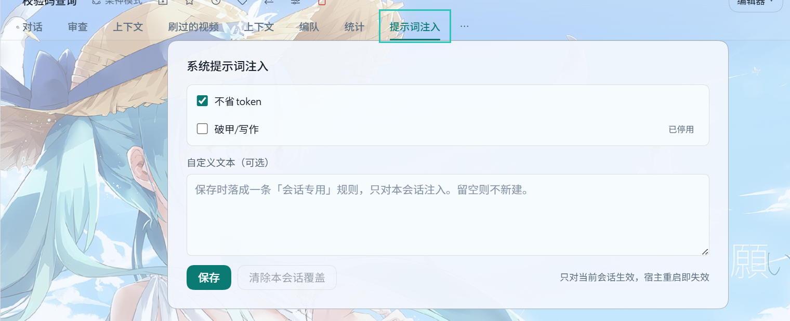

# dsh-prompt-inject

[English](#english) · 简体中文

把若干段提示词按条件追加进 **DeepSeek Harness**（DSH）会话的系统提示词，并在设置页用一张卡片管理它们。

- 命中条件三个维度：**代理模式**（agent preset）、**推理等级**（reasoning effort）、**权限预设**（permission preset）
- 命中后追加进 persona 段尾部，位置在 `Your working directory is …` 之前，不改动任何既有 section
- 正文**逐字**进入系统提示词：其中的 `{{…}}` 原样保留，不会被宿主当成模板变量展开
- 每条规则每轮实时求值：改完配置立刻生效，不用重启
- 会话级覆盖：每个会话可以单独勾选要注入哪些规则，覆盖掉条件判定

## 截图

设置页的规则卡片：模式 / 推理等级 / 权限三个维度都是可勾选的 chip 列表——勾满即「全部」，点「全不选」则该规则不注入。


会话顶部标签行里的「提示词注入」标签（与「对话 / 审查 / 上下文 / 统计」并列），按会话勾选这次要注入哪些规则：



## 特性

| | |
|---|---|
| 严格三态条件 | 每个维度只有「全部 / 指定若干 / 不生效」三种状态，没有隐含通配 |
| 中文显示名 | 预设、权限、推理等级都显示宿主给出的中文名（`梁神模式`、`仅可查看`、`高`…） |
| 零依赖、零构建 | 宿主半区是纯 ESM；浏览器半区是手写 `ModuleLoader` bundle，只 require `react` |
| 会话级覆盖 | 会话顶部标签行里的「提示词注入」标签（新会话空白态走开场区按钮），按会话勾选规则；覆盖只存内存，不落盘 |
| 可测 | 宿主 86 例、浏览器 60 项断言，全部无第三方测试框架 |

## 环境要求

- DeepSeek Harness 桌面版或 `dsh web`（插件走 Cordis 服务与 `system-prompt/assemble` 钩子）
- Node ≥ 22（只在自检与打包时用到；插件运行时零依赖）

## 安装

先下载：[最新发布](https://github.com/L1ants-Trr13eum/dsh-prompt-inject/releases/latest)。`dsh-prompt-inject-0.2.5.zip` 是完整分发包（含安装脚本与独立 README），`dsh-prompt-inject-0.2.5.tgz` 是 npm 风格的插件包，给下面的 CLI 命令用。

**A. 官方 CLI（推荐）**

```bash
dsh plugin --profile desktop add ./dsh-prompt-inject-0.2.5.tgz
```

**B. 手工**

把包放进 `<DSH_HOME>/profiles/<profile>/node_modules/dsh-prompt-inject`（链接或解压皆可），
再在 `<DSH_HOME>/profiles/<profile>/cordis.patch.yml` 末尾追加：

```yaml
- insert:
    - id: prompt-inject
      name: dsh-prompt-inject
```

> A、B 二选一。同时存在会挂载两份、`/api/prompt-inject/*` 重复注册而失败。
> 装完重启 dsh web（或桌面端）生效。

## 配置

`<DSH_HOME>/prompt-inject/config.json`（`DSH_HOME` 默认 `~/.dsh`，也可以在设置卡片里改，卡片保存时原子写盘）：

```json
{
  "version": 1,
  "enabled": true,
  "rules": [
    {
      "id": "r-demo",
      "name": "示例规则",
      "enabled": true,
      "text": "记住：这段文字会逐字进入系统提示词。",
      "when": { "presets": ["liangshen"], "efforts": "all", "permissions": "all" }
    }
  ]
}
```

### 维度语义（严格三态）

| 值 | 含义 |
|---|---|
| `"all"` | 该维度上对所有会话生效 |
| `["liangshen", …]` | 只在这些取值上生效 |
| 键缺失 / `[]` | 该维度不生效 ⇒ **整条规则不注入**（卡片上标「未完成」） |

三个维度都处于生效态，规则才可能命中；会话事实取不到时 `"all"` 仍通过，具体值列表不通过。
命中多条时按配置顺序用空行拼接，重复文本自动跳过。

## 设置卡片

`设置 → 提示词注入`。版式对齐官方设置分区（与「模型」「通用」同一套尺寸与颜色 token）：

- **折叠行**：规则名 + 一行条件摘要（只列被限定的维度，如 `仅 梁神模式 · 等级 高`；都不限时显示 `所有会话`），右侧是启停开关与展开箭头。整行可点，hover 铺底色；条件没补全的规则默认展开
- **展开后**：名称、正文，然后一行三列维度控件（模式 / 推理等级 / 权限）。候选值铺成一排可勾选的 chip，右上角一个「全选 / 全不选」；勾满存 `"all"`，勾一部分存数组，一个都不勾就是该维度不生效
- chip 显示宿主给的中文名；配置里残留的旧 id 也照样列出来（名字回落成 id），不会凭空消失
- 候选值永不空：`/options` 失败时客户端用同源静态表 + 草稿已有 id 兜底，配置仍能改、能存
- 底部：脏标记、保存、放弃；未保存时关闭设置页会拦一次

## 会话级注入

会话顶部标签行里有一个「提示词注入」标签，与「对话 / 审查 / 上下文 / 统计」并列（注册在 `conversation.view` 上，`order:900`）。点进去就是覆盖面板，直接铺在正文区，没有弹窗遮罩。

新会话停在空白态时标签行整行不渲染，那时改用开场区（`conversation.hero.options`）的同一个按钮，点开是同一个面板的弹窗形态——两种形态只有外壳不同：

- 列出配置里的**所有**规则（停用的也列出来，标「已停用」、默认不勾）
- 保存后宿主只注入勾中的规则，**完全忽略它们的 `when` 条件**
- 没设过覆盖的会话行为不变，仍按三维度条件命中
- 「自定义文本」保存时落成一条会话专用规则（`when:{}`，只能被显式选中），正文同样逐字注入
- 「清除本会话覆盖」回到按条件命中
- 会话还没建好时先按「所有启用规则」预勾选，保存只是暂存，发出第一句拿到 sessionId 后自动写入

覆盖只存在宿主内存，会话结束或宿主重启即失效。

## HTTP 接口

全部挂在 `/api/prompt-inject` 下，同源校验、body ≤ 256KB；GET 不做同源校验。

| 方法 | 路径 | 说明 |
|---|---|---|
| GET | `/config` | 读配置；文件不存在返回默认值（不落盘） |
| POST | `/config` | 全量写配置；结构非法 400、跨源 403、超限 413；成功回显归一化后的配置 |
| GET | `/options` | 候选值与显示名：`presets` / `permissions` / `efforts`，每项 `{ id, label }` |
| GET | `/session?sessionId=<id>` | 该会话的 `override`、按条件会命中的 `defaultRuleIds`、全部规则表 |
| POST | `/session` | body `{ sessionId, ruleIds, customText? }`；未知 ruleId 400、正文超 20000 字符 413 |
| DELETE | `/session?sessionId=<id>` | 清除该会话覆盖 |

### 显示名从哪来

- **模式**：`await ctx.agentPresets.list()` 的 `name`（第三方预设自带，例如 `梁神模式`）→ 内置表 `standard=标准模式 / ptc=PTC 模式 / minimal=极简模式 / cordis=创造模式` → id
- **权限**：`ctx.permissionPresets.catalog()` 的行 → 内置表 `read-only=仅可查看 / workspace-write=工作区内修改 / danger-full-access=完全权限 / auto=自动审查` → 值本身
- **推理等级**：`ctx.get('llm')` → `listProviders()` → `await listModels()` → `await resolveModelInfo()` → `reasoning.efforts`（真实适配器广告的等级，例如 `off`/`low`/`high`/`max`），中文表 `off=关闭 / low=低 / medium=中 / high=高 / max=最高` 优先，其次适配器给的 `name`，最后回落 id
- 单个 provider 或 model 失败只跳过；整体 8 秒上限，成功结果缓存 120 秒；都拿不到时退回静态 `低/中/高` 并并入配置里已用到的 id

## 打包

仓库不提交打包产物。要出分发包：

```bash
node scripts/build-dist.mjs
```

产出 `<name>-<version>.tgz`（官方包格式）、`dist/<name>-<version>/`（含 `install.sh`/`install.ps1`）与 `dist/<name>-<version>.zip`。
打包优先用 `npm pack` / `pnpm pack`，两者都没有时用脚本内置的 ustar+gzip 写入器，所以离线机器也能出包。

## 自检

```bash
npm test                      # 两个套件一起跑
node test/00-all.mjs          # 宿主半区：86 例（14+11+22+18+21）
node test/client-bundle.mjs   # 浏览器半区：60 项（桩 React / primitives / document / fetch）
```

CI 在 Ubuntu 与 Windows 上跑 Node 22 与 24（`.github/workflows/ci.yml`）。

## 卸载

删掉 profile 里的 `insert` 行（或 `dsh plugin remove`）并重启。`<DSH_HOME>/prompt-inject/config.json` 会保留，重新装回即恢复。

## 已知边界

- 追加位置固定在 persona 段。若某个 preset 把该段声明为 `complete`，`dsh-system-prompt` 会在 waterfall 之后还原它，本插件的追加会被丢弃（当前内置与常见第三方 preset 都没有这个声明）
- 宿主把 section 文本当模板渲染，所以正文里的 `{{` 会被转义成占位符 `{{pinlb}}` 再还原；装配结果里的 `variables` 因此可能多一个 `pinlb` 键，属正常现象
- 设置卡片在「未保存就关闭」时的拦截依赖关闭按钮的类名启发式（`_close` 结尾），宿主改版可能失效（还有 Esc 与 `beforeunload` 兜底）
- 推理等级候选有 120 秒缓存窗口：切换模型后最多两分钟才刷新

## 许可

[MIT](LICENSE) © 2026 Trr1133um

---

# English

[简体中文](#dsh-prompt-inject) · English

Appends condition-scoped prompt snippets to the system prompt of **DeepSeek Harness** (DSH) sessions, and manages them from one settings card.

- Three match dimensions: **agent preset**, **reasoning effort**, **permission preset**
- Matched text is appended to the tail of the persona section, right before `Your working directory is …`; no existing section is rewritten
- Text is injected **verbatim**: `{{…}}` inside it survives as-is instead of being expanded as a host template variable
- Every rule is evaluated on each turn, so edits apply immediately with no restart
- Session-level override: any single session can pick which rules to inject, bypassing the condition check

## Screenshots

The rule card in Settings. Each of the three dimensions (agent preset, reasoning effort, permission preset) is a chip list: check all of them for "all", or clear them all to keep that rule out of every session.


The "提示词注入" (session prompt injection) tab in the session's top tab row, alongside "对话 / 审查 / 上下文 / 统计":


## Features

| | |
|---|---|
| Strict three-state conditions | Each dimension is either "all", an explicit list, or inactive — there is no implicit wildcard |
| Human-readable labels | Presets, permissions and efforts show the host's own display names |
| Zero dependencies, no build step | The host half is plain ESM; the browser half is a hand-written `ModuleLoader` bundle that only requires `react` |
| Session override | A "提示词注入" tab in the session's top tab row (hero-area button for a blank session) lets you tick rules per session; overrides live in memory only |
| Tested | 86 host cases and 60 browser assertions, with no third-party test framework |

## Requirements

- DeepSeek Harness desktop or `dsh web` (the plugin uses Cordis services and the `system-prompt/assemble` hook)
- Node ≥ 22 for tests and packaging only; the plugin itself has no runtime dependencies

## Install

Download first: [latest release](https://github.com/L1ants-Trr13eum/dsh-prompt-inject/releases/latest). `dsh-prompt-inject-0.2.5.zip` is the full distribution (bundled install scripts and its own README); `dsh-prompt-inject-0.2.5.tgz` is the npm-style plugin package used by the CLI command below.

**A. Official CLI (recommended)**

```bash
dsh plugin --profile desktop add ./dsh-prompt-inject-0.2.5.tgz
```

**B. Manual**

Place the package at `<DSH_HOME>/profiles/<profile>/node_modules/dsh-prompt-inject` (a link or an extracted copy),
then append to `<DSH_HOME>/profiles/<profile>/cordis.patch.yml`:

```yaml
- insert:
    - id: prompt-inject
      name: dsh-prompt-inject
```

> Use either A or B. Doing both mounts the plugin twice and `/api/prompt-inject/*` fails to register.
> Restart `dsh web` (or the desktop app) afterwards.

## Configuration

`<DSH_HOME>/prompt-inject/config.json` (`DSH_HOME` defaults to `~/.dsh`; the settings card writes it atomically):

```json
{
  "version": 1,
  "enabled": true,
  "rules": [
    {
      "id": "r-demo",
      "name": "Example rule",
      "enabled": true,
      "text": "Remember: this text enters the system prompt verbatim.",
      "when": { "presets": ["liangshen"], "efforts": "all", "permissions": "all" }
    }
  ]
}
```

### Dimension semantics (strict three-state)

| Value | Meaning |
|---|---|
| `"all"` | Applies to every session on that dimension |
| `["liangshen", …]` | Applies only to those values |
| key missing / `[]` | That dimension is inactive ⇒ **the whole rule is not injected** (the card marks it "incomplete") |

A rule can only match when all three dimensions are active. When session facts are unavailable, `"all"` still passes and explicit lists do not. Multiple matching rules are appended in configuration order, separated by a blank line, and already-present text is skipped.

## Settings card

`Settings → Prompt injection`. The layout follows the official settings sections (same spacing and colour tokens as "Models" and "General").

- **Collapsed row**: rule name plus a one-line condition summary (`Only 梁神模式 · Effort 高`, or `All sessions` when nothing is constrained), with an enable switch and a chevron on the right. The whole row is clickable and highlights on hover; incomplete rules start expanded
- **Expanded**: name, text, then one row with three dimension controls (preset / effort / permission). Candidates are rendered as tickable chips with a "select all / clear" button; a full selection is stored as `"all"`, a partial one as an array, and none means the dimension is inactive
- Chips show the host's display names; ids left over in the config are still listed (their label falls back to the id)
- Candidates are never empty: when `/options` fails the client falls back to a static table plus ids already in the draft, so the card stays editable
- Footer: dirty indicator, save, discard; closing settings with unsaved changes is intercepted once

## Session-level injection

A "提示词注入" tab sits in the session's top tab row, next to "对话 / 审查 / 上下文 / 统计" (registered on `conversation.view`, `order:900`). Opening it renders the override panel inline in the view area — no modal backdrop.

A blank new session has no tab row at all, so the same panel is also reachable through a button on `conversation.hero.options`, which opens the modal form of it. Only the shell differs:

- Lists **every** rule in the config, disabled ones included (marked "disabled", unticked by default)
- Once saved the host injects only the ticked rules and **ignores their `when` conditions entirely**
- Sessions without an override keep the old behaviour and still match by condition
- "Custom text" is saved as a session-only rule (`when:{}`, selectable only here); its text is injected verbatim too
- "Clear this session's override" restores condition matching
- Before the session exists, the panel pre-ticks all enabled rules and saving only stages the override until the first message provides a session id

Overrides live in host memory only: they disappear when the session ends or the host restarts.

## HTTP API

Everything lives under `/api/prompt-inject`; same-origin checks on POST only, body limit 256 KB.

| Method | Path | Description |
|---|---|---|
| GET | `/config` | Read the config; a missing file returns defaults without writing |
| POST | `/config` | Replace the config; 400 invalid, 403 cross-origin, 413 too large; echoes the normalised config |
| GET | `/options` | Candidates with labels: `presets` / `permissions` / `efforts`, each `{ id, label }` |
| GET | `/session?sessionId=<id>` | `override`, condition-matched `defaultRuleIds`, and the rule list |
| POST | `/session` | body `{ sessionId, ruleIds, customText? }`; 400 unknown rule id, 413 text over 20000 chars |
| DELETE | `/session?sessionId=<id>` | Clear that session's override |

### Where the labels come from

- **Presets**: `name` from `await ctx.agentPresets.list()` (third-party presets ship one, e.g. 梁神模式) → built-in table `standard / ptc / minimal / cordis` → id
- **Permissions**: rows of `ctx.permissionPresets.catalog()` → built-in table `read-only / workspace-write / danger-full-access / auto` → the value itself
- **Efforts**: `ctx.get('llm')` → `listProviders()` → `await listModels()` → `await resolveModelInfo()` → `reasoning.efforts`, i.e. what the real adapters advertise (`off`/`low`/`high`/`max` on the DeepSeek adapter). The Chinese table `off=关闭 / low=低 / medium=中 / high=高 / max=最高` wins, then the adapter's `name`, then the id
- A failing provider or model is skipped; the whole lookup is capped at 8 s and successful results are cached for 120 s. If nothing answers, the static `low/medium/high` list is used and any effort already present in the config is merged in

## Packaging

Build artefacts are not committed. To cut a release:

```bash
node scripts/build-dist.mjs
```

It produces `<name>-<version>.tgz` (the official plugin pack), `dist/<name>-<version>/` (with `install.sh` / `install.ps1`) and `dist/<name>-<version>.zip`.
Packing prefers `npm pack` then `pnpm pack`, and falls back to a built-in ustar+gzip writer so an offline machine can still produce a release.

## Tests

```bash
npm test                      # both suites
node test/00-all.mjs          # host half: 86 cases (14+11+22+18+21)
node test/client-bundle.mjs   # browser half: 60 assertions (stubbed React / primitives / document / fetch)
```

CI runs both on Ubuntu and Windows with Node 22 and 24 (`.github/workflows/ci.yml`).

## Uninstall

Remove the `insert` line from the profile (or run `dsh plugin remove`) and restart. `<DSH_HOME>/prompt-inject/config.json` is kept, so reinstalling restores your rules.

## Known limitations

- The append target is fixed to the persona section. If a preset declares that section as `complete`, `dsh-system-prompt` restores it after the waterfall and the appended text is dropped (no known preset does this today)
- The host renders section text as a template, so `{{` in a rule body is escaped to the placeholder `{{pinlb}}` and restored afterwards; the assembly may therefore carry an extra `pinlb` key in `variables`
- Intercepting "closed settings with unsaved changes" relies on the close button's class name (`_close` suffix); a host redesign could break it (Esc and `beforeunload` remain as fallbacks)
- The effort candidate list is cached for 120 s, so switching models can take up to two minutes to show new efforts

## License

[MIT](LICENSE) © 2026 Trr1133um